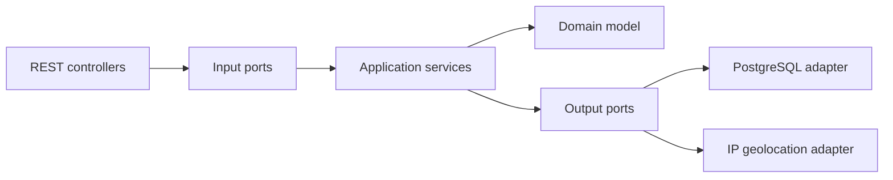
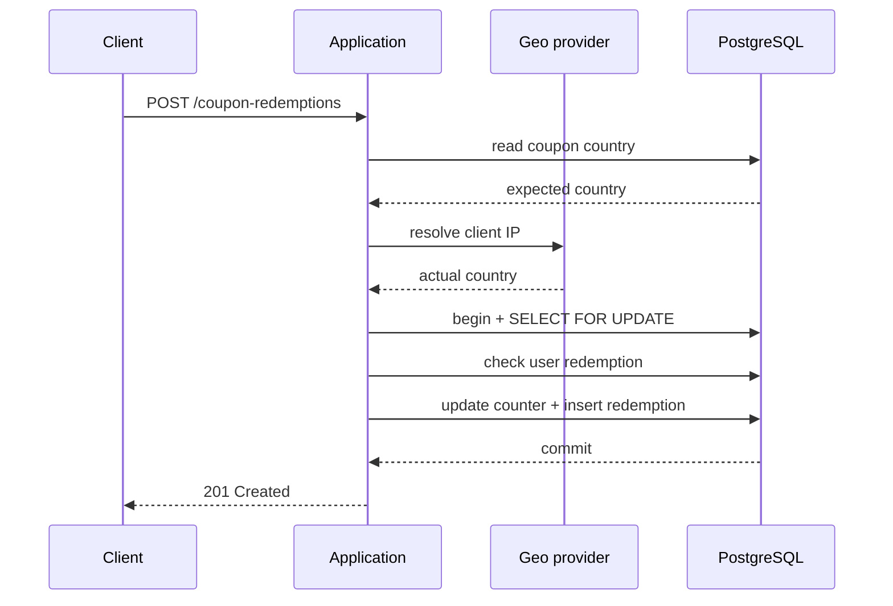

# Coupon Service

Produkcyjnie zorientowany serwis REST do tworzenia i wykorzystywania kuponów rabatowych.
Rozwiązanie realizuje również część opcjonalną zadania: jeden użytkownik może wykorzystać dany kupon tylko raz.

## Najważniejsze cechy

- Java 21 i Spring Boot 3.5.16.
- PostgreSQL jako źródło prawdy oraz Flyway do wersjonowania schematu.
- Architektura ports & adapters z wydzielonym modelem domenowym.
- Bezpieczna obsługa współbieżności na wielu instancjach aplikacji przez blokadę wiersza w PostgreSQL.
- Unikalność kodu kuponu bez rozróżniania wielkości liter.
- Walidacja kraju na podstawie adresu IP przez wymienny port `IpCountryResolver`.
- Adres klienta jest akceptowany wyłącznie jako liczbowy literał IPv4/IPv6; nazwy hostów i niepoprawne adresy są odrzucane bez próby DNS. Wybrane zakresy prywatne, lokalne i specjalnego przeznaczenia są odrzucane przed geolokalizacją.
- Jednorazowe użycie kuponu przez użytkownika zabezpieczone również ograniczeniem unikalności w bazie.
- Błędy w formacie `application/problem+json` z trwałymi kodami biznesowymi.
- Ścisły kontrakt wejściowy: nieznane pola JSON są odrzucane jako `400 MALFORMED_JSON`.
- Testy jednostkowe, testy API, ArchUnit oraz testy integracyjne i współbieżności z Testcontainers.
- Docker Compose, statyczna specyfikacja OpenAPI i CI dla GitHub Actions.

## Pokrycie wymagań

| Wymaganie | Realizacja | Najważniejszy test |
|---|---|---|
| Utworzenie kuponu | `POST /api/v1/coupons` | `CouponControllerTest`, test przez prawdziwe HTTP w `CouponServiceIT` |
| Unikalny kod bez względu na wielkość liter | kanonizacja w `CouponCode`, `CHECK` i `UNIQUE` w PostgreSQL | `CouponCodeTest`, równoległe tworzenie wariantów wielkości liter w `CouponServiceIT` |
| Maksymalna liczba użyć | logika domenowa + `SELECT ... FOR UPDATE` + constraint DB | `CouponTest`, test 50 równoległych prób |
| Ograniczenie do kraju z IP | port `IpCountryResolver`, adapter `country.is`, cache Caffeine | `CountryIsIpCountryResolverTest` |
| Czytelne błędy biznesowe | RFC 9457 `ProblemDetail` i pole `errorCode` | MockMvc oraz test realnego ObjectMappera Boota przez HTTP |
| Jeden użytkownik używa kuponu raz | tabela `coupon_redemptions` i `UNIQUE(coupon_id, user_id)` | test 20 równoległych prób jednego użytkownika |
| Trwałość danych | PostgreSQL + Flyway | `CouponServiceIT` |
| Środowisko wielowątkowe i wiele instancji | blokada jest w bazie, nie w pamięci JVM | testy współbieżności z prawdziwym PostgreSQL |

## Architektura

Kod jest pogrupowany funkcjonalnie, a wewnątrz funkcji kuponów zachowuje kierunek zależności właściwy dla ports & adapters.



```text
pl.empik.couponservice
├── common/config
└── coupon
    ├── api                         # HTTP DTO, kontrolery, Problem Details
    ├── application
    │   ├── command                 # dane wejściowe przypadków użycia
    │   ├── port/in                 # publiczne przypadki użycia
    │   ├── port/out                # kontrakty dla bazy i geolokalizacji
    │   ├── result                  # wyniki przypadków użycia
    │   └── service                 # orkiestracja i granice transakcji
    ├── domain                      # czysta Java, reguły i value objects
    └── infrastructure
        ├── geo                     # country.is / tryb stałego kraju
        └── persistence             # JPA i Spring Data
```

Warstwa domenowa nie zależy od Springa, JPA ani servlet API. Reguły kierunku zależności są dodatkowo sprawdzane testami ArchUnit.

## Krytyczny przepływ wykorzystania kuponu

1. Aplikacja odczytuje kraj przypisany do kuponu. Nieistniejący kod kończy żądanie bez wywołania zewnętrznego API.
2. Kraj klienta jest ustalany **przed rozpoczęciem transakcji**, aby nie utrzymywać połączenia i blokady DB podczas operacji sieciowej.
3. Po pozytywnej walidacji kraju rozpoczyna się krótka transakcja.
4. Kupon jest pobierany przez `PESSIMISTIC_WRITE`, co w PostgreSQL odpowiada blokadzie wiersza.
5. Pod tą samą blokadą aplikacja sprawdza wcześniejsze użycie przez użytkownika i limit kuponu.
6. Licznik jest zwiększany, a rekord wykorzystania zapisywany atomowo w tej samej transakcji.

Encja JPA pobrana z blokadą pozostaje zarządzana w persistence context. Adapter aktualizujący licznik odczytuje więc tę samą instancję z cache pierwszego poziomu, a Hibernate zapisuje zmianę przez dirty checking podczas flush/commit. To świadome wykorzystanie gwarancji JPA, opisane również komentarzem przy implementacji.



### Dlaczego blokada pesymistyczna

Wymaganie „kto pierwszy, ten lepszy” oznacza przede wszystkim brak przekroczenia limitu przy równoległych żądaniach. Przy wielu żądaniach naraz wygrywają te transakcje, które jako pierwsze uzyskają blokadę wiersza; rozwiązanie nie obiecuje globalnej kolejności FIFO liczonej od chwili nadejścia requestu HTTP. Blokada w bazie:

- działa pomiędzy wątkami i różnymi instancjami aplikacji,
- daje prosty i łatwy do obrony model poprawności,
- utrzymuje licznik i historię użyć w jednej transakcji,
- nie wymaga procesu koordynującego ani blokady lokalnej JVM.

Kosztem jest serializacja operacji dla jednego bardzo popularnego kuponu. Jest to świadomy kompromis correctness-first. Alternatywy i warunki przejścia na warunkowy `UPDATE ... RETURNING` opisano w [ADR-0001](docs/adr/0001-redemption-concurrency.md).

## Inwarianty chronione dwukrotnie

Reguły są sprawdzane w modelu domenowym, a kluczowe z nich mają dodatkową ochronę w PostgreSQL:

- `code` jest zapisany w postaci kanonicznej i unikalny,
- `max_uses > 0`,
- `0 <= current_uses <= max_uses`,
- jeden `(coupon_id, user_id)` może wystąpić tylko raz,
- kody krajów mają format dwóch wielkich liter,
- kod kuponu i identyfikator użytkownika nie zawierają znaków kontrolnych, a `userId` nie ma zewnętrznych spacji.

Ograniczenia DB nie zastępują domeny. Stanowią ostatnią linię obrony na wypadek błędu aplikacji, równoległości albo zapisu spoza serwisu.

## API

Pełny kontrakt znajduje się w [`docs/openapi.yaml`](docs/openapi.yaml). Gotowe żądania dla klienta HTTP w IntelliJ są w [`http/coupon-service.http`](http/coupon-service.http).

### Utworzenie kuponu

```http
POST /api/v1/coupons
Content-Type: application/json

{
  "code": "wiosna",
  "maxUses": 10,
  "country": "PL"
}
```

Odpowiedź `201 Created`:

```json
{
  "id": "8fe0f3d0-657f-4a44-9eaa-777c37fb1853",
  "code": "WIOSNA",
  "createdAt": "2026-07-24T08:00:00Z",
  "maxUses": 10,
  "currentUses": 0,
  "remainingUses": 10,
  "country": "PL"
}
```

### Wykorzystanie kuponu

Adres IP nie jest przyjmowany w body. Serwis korzysta z adresu ustalonego przez kontener HTTP (`HttpServletRequest#getRemoteAddr`).

```http
POST /api/v1/coupon-redemptions
Content-Type: application/json

{
  "couponCode": "WIOSNA",
  "userId": "customer-123"
}
```

Odpowiedź `201 Created`:

```json
{
  "redemptionId": "6c55290f-0cde-4f40-a74b-789d8b92e081",
  "couponCode": "WIOSNA",
  "userId": "customer-123",
  "redeemedAt": "2026-07-24T08:02:00Z",
  "currentUses": 1,
  "remainingUses": 9,
  "country": "PL"
}
```

### Błędy

| Status | `errorCode` | Znaczenie |
|---|---|---|
| 400 | `VALIDATION_ERROR`, `INVALID_REQUEST_DATA`, `INVALID_CLIENT_IP`, `MALFORMED_JSON` | niepoprawne wejście |
| 403 | `COUPON_COUNTRY_MISMATCH` | kupon nie jest dostępny w kraju klienta |
| 404 | `COUPON_NOT_FOUND` | kod nie istnieje |
| 409 | `COUPON_ALREADY_EXISTS` | kod został już utworzony |
| 409 | `COUPON_ALREADY_REDEEMED` | użytkownik użył kuponu wcześniej |
| 409 | `COUPON_EXHAUSTED` | limit użyć został osiągnięty |
| 503 | `GEOLOCATION_UNAVAILABLE` | dostawca geolokalizacji jest chwilowo niedostępny |

Przykład:

```json
{
  "type": "urn:problem:coupon-service:coupon-exhausted",
  "title": "Coupon conflict",
  "status": 409,
  "detail": "Coupon with code 'WIOSNA' has reached its usage limit.",
  "instance": "/api/v1/coupon-redemptions",
  "errorCode": "COUPON_EXHAUSTED",
  "timestamp": "2026-07-24T08:03:00Z"
}
```

## Uruchomienie

### Wariant 1: cały system w Docker Compose

Wymagany Docker z obsługą Compose.

```bash
docker compose up --build
```

Serwis będzie dostępny pod `http://localhost:8080`, a health check pod `/actuator/health`.

Compose używa deterministycznego trybu geolokalizacji `fixed` z krajem `PL`. Dzięki temu lokalne żądania z `127.0.0.1` można testować bez udawania publicznego IP.

Zatrzymanie i usunięcie wolumenu:

```bash
docker compose down -v
```

### Wariant 2: IntelliJ IDEA

1. Otwórz katalog projektu przez plik `pom.xml`.
2. Ustaw Project SDK na Java 21.
3. Uruchom sam PostgreSQL:

```bash
docker compose up -d postgres
```

4. W konfiguracji uruchomieniowej klasy `CouponServiceApplication` ustaw aktywny profil `local`:

```text
SPRING_PROFILES_ACTIVE=local
```

Na Windows/PowerShell ten sam profil można ustawić przed uruchomieniem z terminala:

```powershell
$env:SPRING_PROFILES_ACTIVE = "local"
mvn spring-boot:run
```

Profil `local` ustawia kraj klienta na `PL`. Dane połączenia do lokalnej bazy mają domyślne wartości `coupon/coupon` i mogą być nadpisane zmiennymi środowiskowymi.

### Tryb rzeczywistej geolokalizacji

Domyślnie, bez profilu `local`, aktywny jest adapter HTTP korzystający z `country.is`:

```text
APP_GEO_MODE=remote
APP_GEO_BASE_URL=https://api.country.is
APP_GEO_CONNECT_TIMEOUT=1s
APP_GEO_READ_TIMEOUT=2s
APP_GEO_CACHE_TTL=24h
APP_GEO_CACHE_MAXIMUM_SIZE=10000
```

Wynik jest cache'owany po znormalizowanym IP. Błędy dostawcy nie trafiają do cache, więc chwilowa awaria nie blokuje kolejnych poprawnych prób. Nie zapisujemy surowego adresu IP w bazie; zapisany zostaje wyłącznie rozpoznany kod kraju. DTO zewnętrznego dostawcy toleruje dodatkowe pola, podczas gdy publiczne requesty API pozostają ścisłe.

Darmowy zewnętrzny dostawca nie powinien być jedyną zależnością systemu o wysokim SLA. Dla produkcji rekomendowane jest samodzielnie hostowane GeoIP albo dostawca z umową SLA. GeoIP jest też sygnałem przybliżonym (VPN/proxy może zmienić wynik), a przekazanie adresu zewnętrznemu dostawcy wymaga oceny prywatności i podstawy przetwarzania.

### Reverse proxy i adres klienta

Domyślnie `server.forward-headers-strategy=none`, dlatego aplikacja nie ufa samodzielnie nagłówkowi `X-Forwarded-For` przesłanemu przez klienta.

Za kontrolowanym load balancerem lub reverse proxy można ustawić:

```text
SERVER_FORWARD_HEADERS_STRATEGY=native
```

Proxy musi usuwać nagłówki przekazane przez klienta i wstawiać własne. Włączenie obsługi forwarded headers bez zaufanej granicy sieciowej umożliwiłoby podszycie się pod dowolny adres IP.

## Budowanie i testy

Wymagane są Java 21, Maven 3.9+ oraz Docker dla testów Testcontainers.

```bash
mvn -B -ntp clean verify
```

Weryfikacja uruchamia:

- testy domeny i value objects,
- testy serwisów aplikacyjnych z Mockito,
- testy warstwy HTTP przez MockMvc,
- test realnego HTTP na losowym porcie z produkcyjnym ObjectMapperem Spring Boot,
- testy adaptera geolokalizacji, w tym brak cache'owania awarii dostawcy,
- reguły ArchUnit,
- migrację Flyway na prawdziwym PostgreSQL,
- testy integracyjne pełnego cyklu,
- test równoległego tworzenia tego samego kodu w różnych wariantach wielkości liter,
- test 50 równoległych prób przy limicie 10,
- test 20 równoległych prób tego samego użytkownika,
- bramkę JaCoCo: co najmniej 80% linii i 60% gałęzi osobno dla pakietów modelu domenowego, value objects i serwisów aplikacyjnych.

Raport pokrycia po `verify`:

```text
target/site/jacoco/index.html
```

Bez Dockera Testcontainers oznaczy testy integracyjne jako pominięte. Pipeline CI najpierw wykonuje `docker info`, dlatego brak działającego demona kończy build błędem zamiast pozornie zielonym wynikiem bez testów integracyjnych.

## Konfiguracja

| Zmienna | Domyślnie | Opis |
|---|---:|---|
| `SPRING_DATASOURCE_URL` | `jdbc:postgresql://localhost:5432/coupons` | JDBC URL |
| `SPRING_DATASOURCE_USERNAME` | `coupon` | użytkownik DB |
| `SPRING_DATASOURCE_PASSWORD` | `coupon` | hasło DB |
| `DB_POOL_MAX_SIZE` | `20` | maksymalny rozmiar HikariCP |
| `DB_POOL_MIN_IDLE` | `2` | minimalna liczba bezczynnych połączeń HikariCP |
| `APP_GEO_MODE` | `remote` | `remote` lub `fixed` |
| `APP_GEO_FIXED_COUNTRY` | `PL` | kraj w trybie lokalnym |
| `APP_GEO_BASE_URL` | `https://api.country.is` | bazowy URL adaptera HTTP |
| `APP_GEO_CONNECT_TIMEOUT` | `1s` | timeout połączenia |
| `APP_GEO_READ_TIMEOUT` | `2s` | timeout odpowiedzi |
| `APP_GEO_CACHE_TTL` | `24h` | czas życia wpisu cache |
| `APP_GEO_CACHE_MAXIMUM_SIZE` | `10000` | maksymalna liczba wpisów cache |
| `SERVER_FORWARD_HEADERS_STRATEGY` | `none` | obsługa nagłówków proxy |

## Świadome założenia

- Kod kuponu jest przycinany i normalizowany do wielkich liter przy użyciu `Locale.ROOT`.
- `userId` jest nieprzezroczystym identyfikatorem przekazanym przez system nadrzędny. Jest przycinany, ale pozostaje case-sensitive.
- Kraj kuponu i kraj klienta są reprezentowane kodami ISO 3166-1 alpha-2.
- Data utworzenia i użycia jest generowana przez wstrzyknięty `Clock` w UTC, a nie przez klienta.
- Brak uwierzytelniania endpointu tworzącego kupon wynika wprost z zakresu zadania.
- Odpowiedzi `201 Created` nie zawierają `Location`, ponieważ zakres nie przewiduje endpointu `GET` reprezentującego utworzony kupon lub wykorzystanie; zwracanie odnośnika do nieistniejącego zasobu byłoby mylące.
- Nie dodano daty ważności, wartości rabatu ani typu promocji, ponieważ nie występują w wymaganiach.

## Co zostałoby dodane przed produkcją

- uwierzytelnianie i autoryzacja endpointu administracyjnego,
- rate limiting i ochrona przed nadużyciami,
- rozproszony tracing oraz metryki wyników użycia kuponów,
- zarządzanie sekretami poza zmiennymi środowiskowymi,
- dostawca GeoIP z SLA lub lokalna baza GeoIP,
- testy wydajnościowe dla „hot coupon” i decyzja, czy potrzebny jest atomowy SQL zamiast blokady wiersza,
- polityka retencji historii wykorzystań i ocena wymagań RODO,
- niezależny skan zależności i obrazu kontenera w pipeline.
